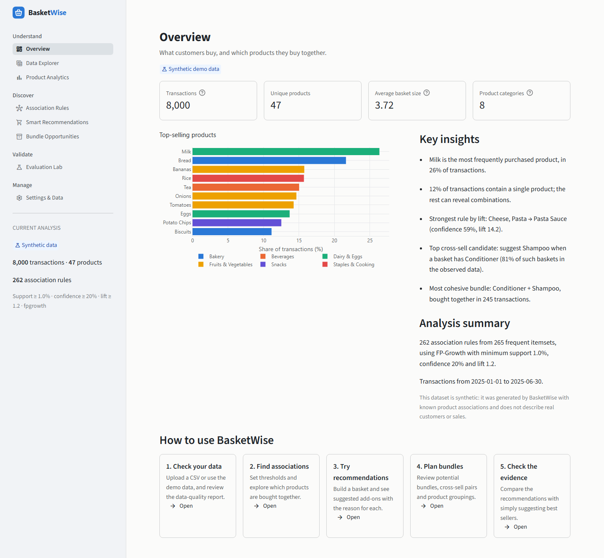
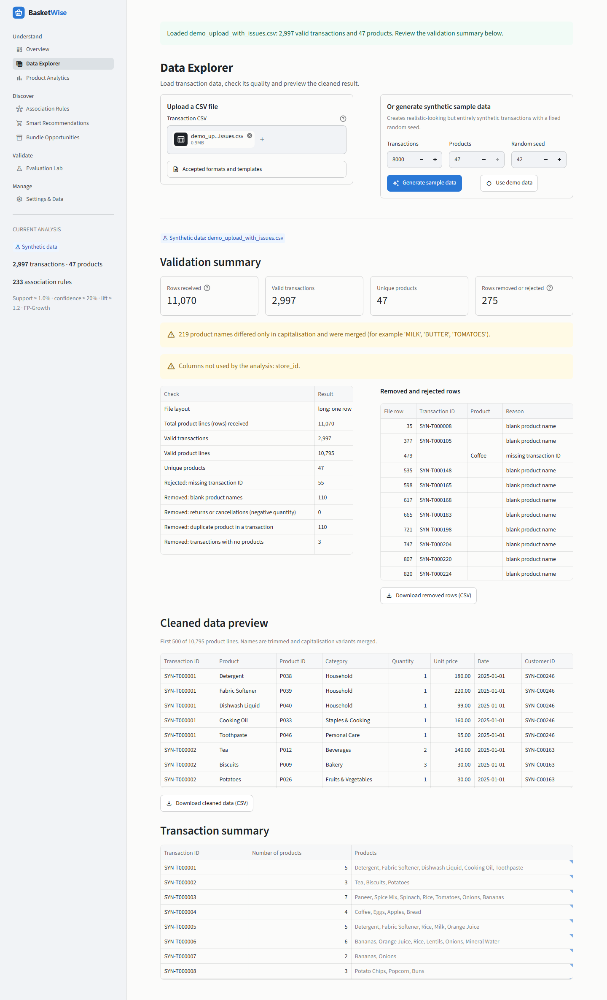
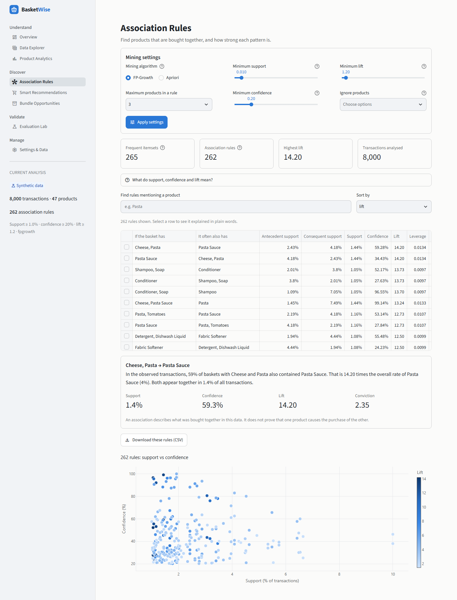
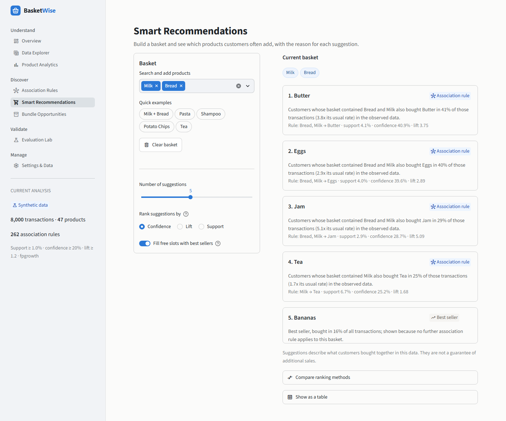
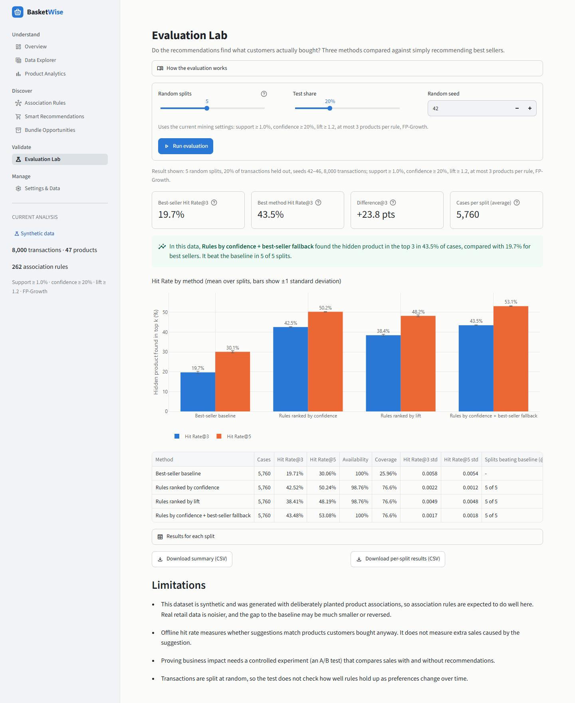
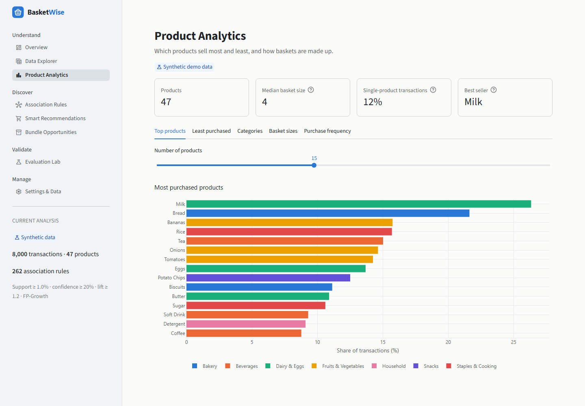
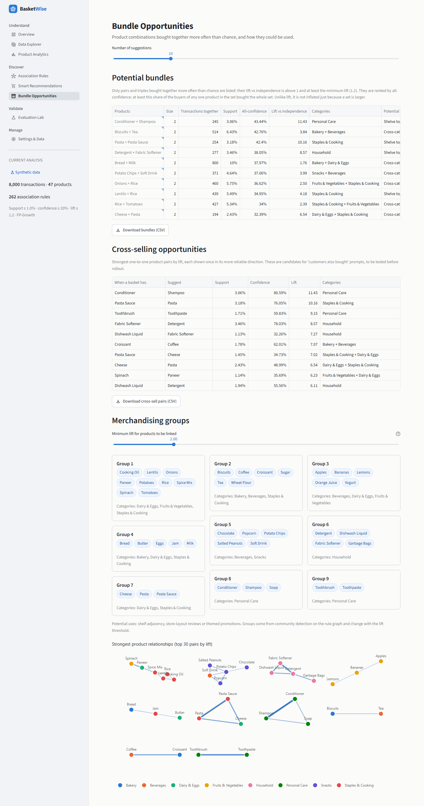
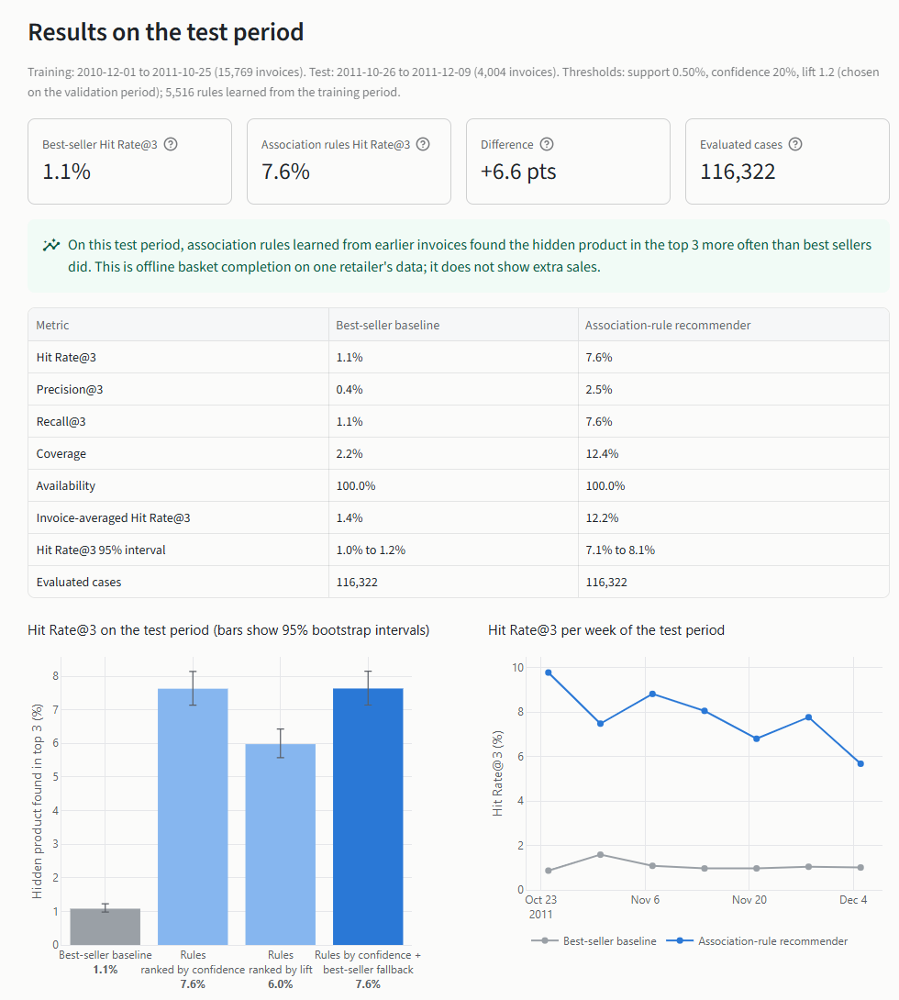

# BasketWise — Retail Basket Intelligence

*Turn everyday transactions into smarter retail decisions.*

BasketWise is a local web app for small and medium-sized retailers. It reads transaction data, checks its quality, finds products that customers buy together, and turns those patterns into explained product recommendations, bundle ideas and merchandising suggestions. It also tests whether its recommendations beat simply suggesting best sellers.

It runs locally on Python and Streamlit, with no accounts, cloud services or paid APIs. The bundled demo dataset is **synthetic**: it was generated by this project and does not describe real customers or sales. A separate, time-based validation on the public **UCI Online Retail** dataset checks the recommender on real transactions (see [Real-world validation](#real-world-validation-uci-online-retail)).



## The problem

Shops record every transaction, but few small retailers can answer simple questions from that data:
- Which products are bought together?
- What should we suggest at checkout?
- Which products belong on the same shelf or in a bundle?

Market basket analysis answers these questions, but the usual tools expect people to know Python and association-rule mining.

BasketWise is aimed at small shop owners, supermarket managers, retail analysts, and merchandising and inventory teams. It presents the analysis in plain business language, with an explanation for every number.

## What BasketWise does

| Need | Where | What happens |
|---|---|---|
| Load data | Data Explorer | Upload a CSV in long format (one row per product) or wide format (one row per transaction), or generate synthetic sample data. |
| Trust the data | Data Explorer | Validation summary, warnings, a preview of the cleaned data, and downloads of removed rows with the reason for each. |
| Understand sales | Product Analytics | Most and least purchased products, category reach, basket sizes, weekly volume and a product frequency table. |
| Find patterns | Association Rules | Choose Apriori or FP-Growth and set support, confidence, lift and maximum rule size, and ignore products such as carrier bags. Search and sort the rules, read a plain-English explanation of each, and export them. |
| Suggest add-ons | Smart Recommendations | Build a basket and get ranked suggestions, each with its reason and supporting rule. Best sellers fill any free slots and are labelled as such; ignored products are never suggested. |
| Plan promotions | Bundle Opportunities | Potential bundles (only sets bought together more often than chance), cross-selling pairs, merchandising groups and a relationship map. |
| Check the evidence | Evaluation Lab | Compares three recommendation methods with a best-seller baseline on held-out transactions over repeated random splits. A second tab runs the real-world validation: UCI Online Retail data split by time. |
| Share results | Settings & Data | Download a Markdown report or a ZIP of all CSV results. Reset the data or settings. |

| | |
|---|---|
|  |  |
|  |  |
|  |  |

The screenshots were captured from the running app with headless Chrome. The Data Explorer screenshot shows `Data/demo_upload_with_issues.csv`, a synthetic file with deliberately injected data problems; the validator reports each injected problem exactly.

## Technology stack

| Layer | Technology | Role |
|---|---|---|
| Language | Python 3.12+ | Everything |
| Data | pandas, NumPy | Reading, validation, cleaning, summaries |
| Mining | mlxtend | One-hot encoding, Apriori, FP-Growth, association rules |
| Graphs | NetworkX | Merchandising groups (community detection) |
| Charts | Plotly | Interactive charts |
| App | Streamlit | Eight-page local web app |
| Real data | openpyxl | Reading the official UCI Online Retail spreadsheet (real-world validation only) |
| Tests | pytest, Streamlit AppTest | 247 automated tests, including interface tests across pages |

## Quick start

You need Python 3.12 or newer, because the pinned NumPy, SciPy and NetworkX versions require it. It was tested with Python 3.13 on Windows.

```powershell
git clone https://github.com/kushant774/basketwise-retail-basket-intelligence.git
cd basketwise-retail-basket-intelligence
py -3.13 -m venv .venv
.venv\Scripts\python -m pip install -r requirements.txt
.venv\Scripts\streamlit run app.py
```

The app opens at <http://localhost:8501>. On macOS or Linux, use `python3 -m venv .venv` and `.venv/bin/` instead of `.venv\Scripts\`.

Other entry points:

```powershell
.venv\Scripts\python scripts/generate_data.py              # regenerate Data/synthetic_retail_transactions.csv (seed 42)
.venv\Scripts\python -m market_basket summary              # command-line tools: summary, validate, rules,
.venv\Scripts\python -m market_basket recommend Milk Bread #   recommend, insights, evaluate, report
.venv\Scripts\python -m market_basket evaluate --splits 5
.venv\Scripts\python -m pytest                             # 247 automated tests
.venv\Scripts\jupyter notebook notebooks/basketwise_walkthrough.ipynb

# real-world validation (downloads the public UCI Online Retail data, about 23 MB, into Data/external/)
.venv\Scripts\python scripts/download_uci_online_retail.py
.venv\Scripts\python -m market_basket uci-prepare       # data-quality report and preprocessing summary
.venv\Scripts\python -m market_basket uci-evaluate      # chronological evaluation -> outputs/real_world/
```

## Using your own data

Upload a CSV (or a tab-separated `.tsv`/`.txt` export) on the Data Explorer page, or run `python -m market_basket validate --data your_file.csv`. Two layouts are accepted:

```text
Long format (one row per product)            Wide format (one row per transaction)
transaction_id,product_name,category,qty     transaction_id,item_1,item_2,item_3
T1001,Milk,Dairy,1                           T1001,Milk,Bread,Butter
T1001,Bread,Bakery,2                         T1002,Tea,Biscuits,
```

**Separators and encodings.** Comma, semicolon, tab and pipe separators are detected automatically. Files may be UTF-8, UTF-16 (Excel's "Unicode text") or Windows-1252 (Excel CSV on Windows, which keeps characters such as ’ – €); a warning names any encoding other than UTF-8.

**Column names.** Matching ignores case, spacing and CamelCase, and accepts common alternatives such as `invoice_no` or `InvoiceNo`, `order_id`, `item`, `product` and `Description`, so the UCI Online Retail headers (`InvoiceNo`, `StockCode`, `Description`, `Quantity`, `InvoiceDate`, `UnitPrice`, `CustomerID`) work as they are. Optional columns are `category`, `quantity`, `unit_price`, `transaction_date`, `customer_id` and `product_id`.

**How rows are cleaned:**
- Missing transaction IDs and blank product names (including placeholders such as `nan`, `NULL`, `#N/A` or `-`) are rejected.
- Rows with a negative quantity are returns or cancellations. They are removed, so a returned product is never counted as a purchase.
- Duplicate lines for the same product in one transaction are merged and their quantities added (each line is treated as a separate scan).
- Extra spaces are removed, names that differ only in capitalisation are merged, and accented characters are stored in one Unicode form.
- Dates may be `yyyy-mm-dd`, day/month/year or month/day/year. The order of day and month is detected from the data; if every date could be either, day/month/year is used and a warning says so. Dates are stored as `yyyy-mm-dd`.
- Every removed row is listed with its reason and can be downloaded.
- Clear warnings appear when more than 5 % of rows are removed, when unused columns are ignored, when dates are ambiguous or unreadable, or when the data is too small to be reliable.

**Files that are refused with a message:**
- empty files
- non-CSV or binary files
- unrecognised column layouts
- rows longer than the header
- files over 50 MB or 2,000,000 rows

**Where your data goes.** Uploaded files are processed in the memory of the running app and are never written to disk. Cleaned data and results are cached in that server memory, shared by every browser session connected to the same running app, and cleared when the app restarts. Run BasketWise on your own computer for private data.

To see validation at work, upload `Data/demo_upload_with_issues.csv`. It is synthetic, made with `python scripts/generate_data.py --transactions 3000 --seed 7 --with-issues --output Data/demo_upload_with_issues.csv`. Files made by the BasketWise generator are recognised by their ID format (`SYN-T…` transactions and `SYN-C…` customers) and labelled synthetic wherever they are loaded.

## Example workflow

One complete journey takes about seven minutes. See [docs/DEMO_WALKTHROUGH.md](docs/DEMO_WALKTHROUGH.md) for the full script and expected numbers.

1. **Data Explorer:** upload `Data/demo_upload_with_issues.csv`. 11,070 rows come in, and 2,997 valid transactions remain. 275 rows are removed, each listed with its reason (missing IDs, blank names, duplicates), and 219 capitalisation variants are merged. The badge marks the file as synthetic.
2. **Association Rules:** the defaults give 233 rules. Searching for `pasta` shows Cheese + Pasta → Pasta Sauce first (confidence 64%, lift 13.8).
3. **Smart Recommendations:** the basket Milk + Bread gives Butter first (44.8% of such baskets), with the reason shown. The basket is kept while you visit other pages.
4. **Bundle Opportunities:** the top bundle is Pasta + Pasta Sauce (all-confidence 43%).
5. **Evaluation Lab:** over 5 splits, Hit Rate@3 is 41.8% for confidence-ranked rules with fallback, against 21.1% for best sellers.
6. **Settings & Data:** download the Markdown report and the ZIP of CSV files.

## How it works

```text
CSV upload / synthetic generator
        │
        ▼
market_basket.data        read, detect layout, validate, clean  ──► validation report, removed rows
        │ transactions
        ▼
market_basket.mining      one-hot encode → size check before mining → mlxtend apriori / fpgrowth
        │                 → mlxtend association_rules → thresholds, ignored products, ranking, explanations
        ├──► market_basket.recommend    explainable recommendations + best-seller fallback
        ├──► market_basket.insights     popularity, categories, cross-sell, bundles, merchandising groups
        ├──► market_basket.evaluation   train/test splits, leave-one-out hit rate vs best-seller baseline
        └──► market_basket.reporting    Markdown report and ZIP of CSV exports
                     │
                     ▼
ui/ + app.py (Streamlit pages)   ·   market_basket/cli.py (command line)   ·   notebook
```

**What mlxtend does.** BasketWise uses the open-source [mlxtend](https://rasbt.github.io/mlxtend/) library for:
- `TransactionEncoder`, which builds the one-hot basket matrix
- `apriori` and `fpgrowth`, which find frequent itemsets
- `association_rules`, which computes support, confidence, lift, leverage and conviction

These algorithms are not reimplemented here. BasketWise's own code covers everything around them:
- the synthetic data generator, data validation and cleaning
- settings, safety limits checked before mining, rule filtering and ranking, and explanations
- the recommendation engine and its fallback
- the evaluation framework
- business insights, charts, reports, the app and the CLI

**The three main metrics:**

| Metric | Formula | Plain meaning |
|---|---|---|
| Support | support(A) = transactions containing A / total transactions | How common a product or combination is |
| Confidence | confidence(A → B) = support(A ∪ B) / support(A) | Of the baskets with A, the share that also had B |
| Lift | lift(A → B) = confidence(A → B) / support(B) | How many times more often B appears with A than overall |

Lift above 1 indicates a positive association in the observed data. It is not proof that A causes the purchase of B. See [docs/ALGORITHM_EXPLANATION.md](docs/ALGORITHM_EXPLANATION.md) for leverage, conviction, all-confidence and a worked example.

**How recommendations work.** For a basket, a rule A → B applies when every product in A is already in the basket and B is not. BasketWise then:
- Ranks the applicable rules by confidence (the default), by lift or by support.
- Suggests each product once, through its best rule, with a reason. For example: *"Customers whose basket contained Bread and Milk also bought Butter in 41% of those transactions (3.8x its usual rate) in the observed data."*
- Fills any remaining slots with best sellers, labelled as best sellers.
- Never suggests a product you chose to ignore, not even as a best seller.

## Evaluation and results

This section is the **synthetic benchmark**. The [real-world validation](#real-world-validation-uci-online-retail) below is a separate experiment with different data, split and settings; the two sets of numbers must not be combined.

**Method.** Three recommendation methods are compared with a best-seller baseline. Each of these steps is reproducible:
1. Shuffle the transactions with a fixed seed and split them 80/20 into training and test sets.
2. Mine the rules and compute best sellers from the training split only.
3. In every test transaction with at least two products, hide each product in turn and ask each method for recommendations based on the remaining products.
4. Score a hit if the hidden product appears in the top 3 (Hit Rate@3) or top 5 (Hit Rate@5).
5. Repeat over several random splits.

Results on the demo data come from `python -m market_basket evaluate --splits 5`: seeds 42–46, default settings, on average 5,760 evaluated cases per split (5,683–5,896).

| Method | Hit Rate@3 | Hit Rate@5 | Availability | Coverage |
|---|---|---|---|---|
| Best-seller baseline | 19.7 % | 30.1 % | 100 % | 26.0 % |
| Rules ranked by confidence | 42.5 % | 50.2 % | 98.8 % | 76.6 % |
| Rules ranked by lift | 38.4 % | 48.2 % | 98.8 % | 76.6 % |
| Rules by confidence + best-seller fallback | **43.5 %** | **53.1 %** | 100 % | 76.6 % |

Every rule-based method beat the baseline in all 5 splits. The standard deviation across splits was 0.6 percentage points or less.

**How to read this honestly:**
- The synthetic generator deliberately plants product associations, so the rules are expected to do well here. The result shows that the pipeline recovers the planted structure; it does not predict performance in a real shop.
- The default ranking (confidence) and thresholds were chosen after looking at results like these on the same demo data, so the default method's lead is slightly optimistic. This selection effect is small next to the 20-point gap to the baseline, but it means the comparison is not a fully held-out test.
- Offline hit rate rewards suggesting products the customer would have bought anyway. Only a controlled A/B test can measure extra sales.
- See [docs/EVALUATION_REPORT.md](docs/EVALUATION_REPORT.md) for details.

**Example findings on the demo data:**
- The strongest cross-sell pair is Conditioner → Shampoo (confidence 81 %, lift 11.4).
- The most cohesive bundle is Conditioner + Shampoo (245 transactions together). Bread + Milk appears in the most transactions together (800).
- The merchandising groups match the planted shopping missions, such as pasta night (Pasta, Pasta Sauce, Cheese) and laundry (Detergent, Fabric Softener, Dishwash Liquid, Garbage Bags).

## Real-world validation (UCI Online Retail)

**Why it was added.** The synthetic data plants its own associations, so the benchmark above can only show that the pipeline recovers known structure. This experiment tests the same recommender on real transactions, and by time. It learns from earlier invoices and tests on later ones, which is closer to how rules would be used than a random split.

**Data.** Chen, D. (2015). *Online Retail* [Dataset]. UCI Machine Learning Repository. <https://doi.org/10.24432/C5BW33>, licensed under [CC BY 4.0](https://creativecommons.org/licenses/by/4.0/legalcode). The dataset holds 541,909 rows of transactions (December 2010 to December 2011) from a UK-based online gift retailer. It is **not** stored in this repository: `scripts/download_uci_online_retail.py` downloads the official file and records its checksums.

**Preprocessing.**
- Returns and cancellations are removed, and so are adjustments, postage and other service lines, non-positive quantities or prices, and duplicates.
- Every removed row keeps its reason.
- Products are identified by stock code.
- The result is 19,773 invoices with 3,797 products.

**Method.**
- **Split:** the latest 20 % of invoices form the test period (26 October to 9 December 2011). Rules and best sellers are learned only from the training period before it.
- **Thresholds:** chosen on a validation period at the end of the training period. The test period is never used to choose them.
- **Scoring:** in every test invoice, each product is hidden once. Both methods are scored on the same 116,322 cases.

| Metric (test period) | Best-seller baseline | Association-rule recommender |
|---|---:|---:|
| Hit Rate@3 | 1.1 % | **7.6 %** |
| Precision@3 | 0.4 % | 2.5 % |
| Recall@3 | 1.1 % | 7.6 % |
| Coverage | 2.2 % | 12.4 % |

**How to read it honestly:**
- The difference is clear: +6.6 points, with a 95 % interval of +6.0 to +7.1 from resampling test invoices.
- But both rates are low. The recommender still missed the hidden product in 92 % of cases, in a catalogue of 3,797 products.
- Its weekly hit rate fell from 9.8 % to 5.7 % across the test period, as the pre-Christmas season moved further from the training data.
- With one hidden product per case, Recall@3 equals Hit Rate@3, and Precision@3 is a third of it.

**What it does not show:** next-purchase prediction, extra sales or revenue (that needs an A/B test), real customer adoption, or results for other shops and periods. It is one retailer and one split.



Run it with the three `real-world validation` commands in the [Quick start](#quick-start), or in the app under **Evaluation Lab → Real-world validation (UCI data, split by time)**. A run takes about 1.5 minutes and about 700 MB of memory. Details are in [docs/REAL_WORLD_VALIDATION.md](docs/REAL_WORLD_VALIDATION.md). The full generated report is [docs/real_world/real_world_evaluation.md](docs/real_world/real_world_evaluation.md), and the machine-readable results are [docs/real_world/real_world_evaluation.json](docs/real_world/real_world_evaluation.json).

## Project structure

```text
app.py                       Streamlit entry point
ui/                          state.py (session + caching), components.py, navigation.py, views/ (8 pages)
market_basket/               config, synthetic_data, data, mining, recommend, evaluation, insights, plots,
                             reporting, cli; uci, temporal, real_world (real-world validation)
Data/synthetic_retail_transactions.csv   generated demo data (8,000 transactions, 47 products, 8 categories)
Data/demo_upload_with_issues.csv         generated upload with known data problems (for the demo)
scripts/generate_data.py     regenerates the demo data
scripts/benchmark.py         Apriori vs FP-Growth timing
scripts/download_uci_online_retail.py   downloads the UCI Online Retail data (into Data/external/, ignored by Git)
notebooks/basketwise_walkthrough.ipynb   step-by-step analysis using the package
tests/                       247 pytest tests (data, mining, recommendations, evaluation, real-world validation,
                             reports, CLI, app)
docs/                        product, architecture, algorithm, evaluation, testing and interview documents
docs/real_world/             generated real-world validation report, results JSON and summaries
```

## Limitations

- The demo data is synthetic. Its associations are cleaner and stronger than real retail data (several lifts above 10), so real results will differ.
- Association rules describe co-occurrence, not causation, and offline hit rate is not business impact.
- The synthetic benchmark splits transactions at random. The real-world validation splits by time, but it covers one retailer, one year and one split, and its rules have at most two products. The rules are learned once; there is no periodic re-mining.
- Products below the minimum support never appear in rules, and recommendations cannot use price, margin, stock or customer history.
- When every date in a file could be read either way (for example 05/01/2025), day/month/year is assumed; a US file with no day above 12 would be misread, and a warning says so.
- To stay responsive, settings that could produce more than 200,000 frequent itemsets or 500,000 candidate rules are refused with a message (the itemset limit is checked before mining starts). On large catalogues, keep a maximum rule size.
- The app runs locally for a single user. It is not deployed, has no authentication and keeps no history between sessions.
- Scaling was benchmarked up to 120,000 synthetic transactions with 47 products, not on large catalogues. Timings depend on the computer.

## Future improvements

These are not implemented:
- periodic re-mining (the real-world validation shows rules losing accuracy over a few weeks)
- margin-aware ranking
- statistical significance filters for rules
- an A/B test integration
- support for very large catalogues
- deployment with authentication

## Repository history and originality

The current BasketWise implementation was rebuilt. Earlier commits in this repository contain notebooks, a README and a dataset copied from public GitHub repositories and tutorials. That material has been removed from the current working tree, and the current application does not use it. The Git history was kept as it is and not rewritten.

The current code was developed with AI coding assistance and reviewed and tested by the author. See [docs/ORIGINALITY_AND_AI_ASSISTANCE.md](docs/ORIGINALITY_AND_AI_ASSISTANCE.md).

The real-world validation uses the UCI Online Retail dataset (Chen, 2015, CC BY 4.0), which is downloaded from the UCI Machine Learning Repository and not redistributed here.

## Documentation

- [Demo walkthrough](docs/DEMO_WALKTHROUGH.md)
- [Product requirements](docs/PRODUCT_REQUIREMENTS.md)
- [Product decisions](docs/PRODUCT_DECISIONS.md)
- [Architecture](docs/ARCHITECTURE.md)
- [Data dictionary](docs/DATA_DICTIONARY.md)
- [Algorithm explanation](docs/ALGORITHM_EXPLANATION.md)
- [Evaluation report](docs/EVALUATION_REPORT.md) (synthetic benchmark)
- [Real-world validation](docs/REAL_WORLD_VALIDATION.md) and its [generated report](docs/real_world/real_world_evaluation.md)
- [Testing report](docs/TESTING_REPORT.md)
- [Interview preparation](docs/INTERVIEW_PREPARATION.md)
- [Originality and AI assistance](docs/ORIGINALITY_AND_AI_ASSISTANCE.md)
