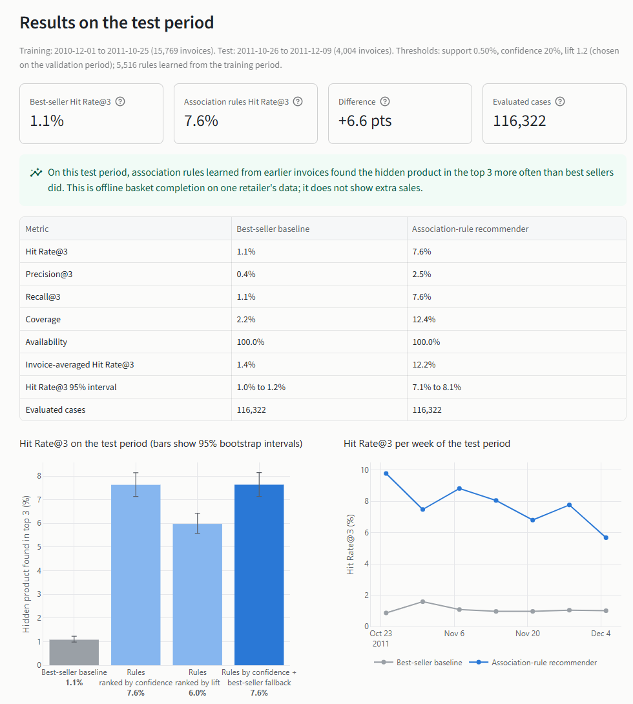

# BasketWise — Real-world validation (UCI Online Retail)

BasketWise's published benchmark uses synthetic data with planted associations, so it can only show that the pipeline recovers known structure. This experiment tests the same recommender on **real transactions** from a public dataset, and **by time**: rules and best sellers are learned from earlier invoices only and tested on later invoices.

The full generated report, with every number, is [docs/real_world/real_world_evaluation.md](real_world/real_world_evaluation.md). Its machine-readable version is [docs/real_world/real_world_evaluation.json](real_world/real_world_evaluation.json). Every number below comes from those files. They were produced by `python -m market_basket uci-evaluate` with the default settings on the official file, downloaded on 14 November 2026.

## Result at a glance

**Question:** if one product of a later invoice is hidden, do rules learned from earlier invoices put it in the top 3 suggestions more often than the best sellers do?

- **Training period:** 1 December 2010 to 25 October 2011 (15,769 invoices).
- **Test period:** 26 October to 9 December 2011 (4,004 invoices).
- **Cases:** 116,322 leave-one-out cases from the 3,728 test invoices with at least two products. Every method is scored on the same cases.

| Metric | Best-seller baseline | Association-rule recommender |
|---|---:|---:|
| Hit Rate@3 | 1.1 % | **7.6 %** |
| Precision@3 | 0.4 % | 2.5 % |
| Recall@3 | 1.1 % | 7.6 % |
| Coverage | 2.2 % | 12.4 % |
| Availability | 100 % | 100 % |
| Invoice-averaged Hit Rate@3 | 1.4 % | 12.2 % |
| Hit Rate@3, 95 % interval | 1.0 – 1.2 % | 7.1 – 8.1 % |

- **Recommender:** BasketWise's default, rules ranked by confidence, with best sellers filling any free slots.
- **Settings:** minimum support 0.5 %, minimum confidence 20 % and minimum lift 1.2, with at most 2 products per rule. These were chosen on a validation period inside the training period. The training period gave 5,516 rules.
- **Difference:** the recommender scored +6.6 percentage points higher (95 % interval +6.0 to +7.1). The interval comes from resampling whole test invoices, with the same resamples for both methods.

## How to read this

- **The difference is clear, but both numbers are low.** The recommender missed the hidden product in 92.4 % of cases. Best sellers missed it in 98.9 %. The catalogue has 3,797 products, many customers are wholesalers with very large orders, and the top 3 slots are few, so the absolute hit rates are small.
- **Large invoices are harder.** The median test invoice gives 17 cases, but the largest gives 1,106. Weighting every invoice equally gives 12.2 % for the recommender against 1.4 % for best sellers, so the advantage is not driven by a few huge orders.
- **Performance fell over the test period.** The recommender's weekly Hit Rate@3 went from 9.8 % in the first test week to 5.7 % in the last (week of 5 December). Best sellers stayed around 1 %. Rules learned up to October fit November and December less well. The data cannot separate the time since training from the pre-Christmas peak.
- **The test score is lower than the validation score.** The chosen setting scored 9.3 % on the validation period (5 September to 25 October 2011) and 7.6 % on the test period. A drop is expected: the setting was chosen as the best of nine on validation, and the test period is later.
- **The best-seller fallback hardly matters here.** At least one rule applied in 99.3 % of cases. "Rules ranked by confidence" without the fallback scores the same 7.6 %. Ranking by lift scores 6.0 % but recommends more distinct products (14.9 % coverage), the same trade-off as in the synthetic benchmark.
- **Precision@3 and Recall@3 add no separate evidence.** With one hidden product per case, Recall@3 equals Hit Rate@3, and Precision@3 is Hit Rate@3 divided by 3. They are reported because they are standard, not as extra evidence.

## What this experiment does not show

- **No next-purchase or next-order prediction.** The hidden product comes from the same invoice, and the rest of that invoice is the context.
- **No effect on sales, revenue or margin.** A hit means the suggestion matched a product the customer bought anyway. Measuring extra sales needs a controlled experiment such as an A/B test.
- **No real customer adoption.** No recommendation was shown to anyone.
- **No generalisation to other shops or periods.** The data comes from one UK-based online gift retailer over about one year, and the evaluation uses one chronological split.

## How it differs from the synthetic benchmark

These are two separate experiments. Their numbers must not be combined, averaged or compared as one benchmark.

| | Synthetic benchmark (`docs/EVALUATION_REPORT.md`) | Real-world validation (this document) |
|---|---|---|
| Data | 8,000 generated transactions, 47 products, planted associations | 19,773 real invoices, 3,797 products |
| Split | 5 random 80/20 splits | One split by time: the latest 20 % of invoices form the test period |
| Settings | App defaults (support 1 %, at most 3 products per rule) | Chosen on a validation period: support 0.5 %, confidence 20 %, lift 1.2, at most 2 products per rule |
| What it shows | The pipeline recovers known structure without leakage | Rules learned from the past still help complete later real baskets, by a small absolute margin |

## The dataset

Chen, D. (2015). *Online Retail* [Dataset]. UCI Machine Learning Repository. <https://doi.org/10.24432/C5BW33>. Licensed under [Creative Commons Attribution 4.0 International (CC BY 4.0)](https://creativecommons.org/licenses/by/4.0/legalcode).

UCI describes the data as all transactions between 1 December 2010 and 9 December 2011 of a UK-based, non-store online retailer that mainly sells all-occasion gifts, and many of its customers are wholesalers. The raw file is **not** stored in this repository; the download script fetches it from the official page. The summaries and results in `docs/real_world/` are derived from it.

**Data quality (raw table, 541,909 rows):**
- **Cancellations:** 3,836 cancellation invoices (9,288 rows, all with negative quantities) and 3 bad-debt adjustment invoices.
- **Quantities and prices:** 1,336 other rows with negative quantities (stock adjustments), 2,515 zero-price rows and 2 negative prices.
- **Customers and duplicates:** 135,080 rows without a customer ID, and 5,268 exact duplicate rows.
- **Service lines:** 3,028 rows for postage, fees, discounts and other service items.
- **Stock codes:** 117 lower-case stock codes. 112 of them also appear in upper case, and 110 of those share a description with their upper-case twin. 68 descriptions belong to several different stock codes.
- **Dates:** no invalid dates. They run from 1 December 2010 to 9 December 2011.

**Preprocessing:**
- **Products** are identified by stock code; descriptions are display names only.
- **Removed rows:** returns, cancellations, adjustments, service lines and non-positive quantities or prices. Exact duplicates are removed, and repeated lines of a product in one invoice are merged.
- **Missing customer IDs** are kept, because a basket is an invoice.
- **Result:** 517,210 basket lines in 19,773 invoices (18,267 with at least two products), with 3,797 products and 4,334 customers. 1,371 valid invoices have no customer ID.
- **Audit trail:** every removed row keeps its reason, in `outputs/real_world/removed_rows.csv.gz`.

## How to reproduce

From the project root, with the environment from the README:

```powershell
.venv\Scripts\python scripts/download_uci_online_retail.py   # official ZIP -> Data/external/uci_online_retail/ (about 23 MB)
.venv\Scripts\python -m market_basket uci-prepare            # data-quality report and preprocessing summary
.venv\Scripts\python -m market_basket uci-evaluate           # full evaluation -> outputs/real_world/
```

- **Download.** The script records the source, the retrieval time and SHA-256 checksums in `download_manifest.json`. A ZIP that is already there is reused (`--force` downloads it again). The UCI server is slow and sometimes drops the connection, so the script retries up to three times. If the site is unavailable, put the ZIP from <https://archive.ics.uci.edu/static/public/352/online+retail.zip> into `Data/external/uci_online_retail/online_retail.zip` and run the script again.
- **Evaluation options.** `uci-evaluate` accepts `--cutoff YYYY-MM-DD` or `--test-share`, `--validation-share`, `--min-support`, `--min-confidence` and `--min-lift`, `--max-len`, `--top-k`, `--bootstrap`, `--seed`, `--require-customer-id`, `--data` and `--output-dir`. The three threshold options take one value, or several candidates that are then compared on the validation period.
- **Default protocol.** The generated report says whether a run matches the default protocol on the official file. That protocol was fixed before the test period was first scored.
- **In the app.** Open **Evaluation Lab → Real-world validation (UCI data, split by time)**, click **Load and check the dataset**, then **Run chronological evaluation**. The app shows the data-quality summary, the settings, the comparison, the charts and the limitations, and offers JSON, Markdown and ZIP downloads. They are identical to the CLI outputs apart from the generation time.
- **Reproducibility.** Two runs with the same file and settings gave byte-identical CSV and gzip outputs, and the same JSON and Markdown apart from the generation time.

**Resources** (one Windows laptop, Python 3.13): one CLI run took 77–82 s with a peak of about 680 MB of memory, mostly the nine validation runs; the app tab took about 72 s. The data is read as text columns, and baskets are encoded as sparse matrices.



## Method in brief

The full protocol, with the tie rules, is in the module docstring of `market_basket/temporal.py` and in section 5 of the generated report.

1. **Split by time.** The cutoff is midnight at the start of the day that contains the first invoice of the latest 20 % of invoices: 26 October 2011. Every training invoice is earlier than every test invoice, and no invoice is split.
2. **Choose thresholds on validation.** Nine settings (support 0.5, 1 or 2 % × confidence 10, 20 or 30 %, lift 1.2) were compared on the latest 20 % of the training invoices, with rules learned from the earlier part. The test period was never used to choose.
3. **Learn from the training period.** Rules and best sellers were learned from the whole training period with the chosen setting.
4. **Score the test period.** In every test invoice with at least two products, each product was hidden once. The products bought in the training period are the candidates. Hidden products that were never sold in training (1.1 % of cases) stay in the denominator as misses for every method.

The product decisions behind these choices are recorded in [PRODUCT_DECISIONS.md](PRODUCT_DECISIONS.md) (decisions 18–24). The limitations are listed in section 9 of the generated report.
